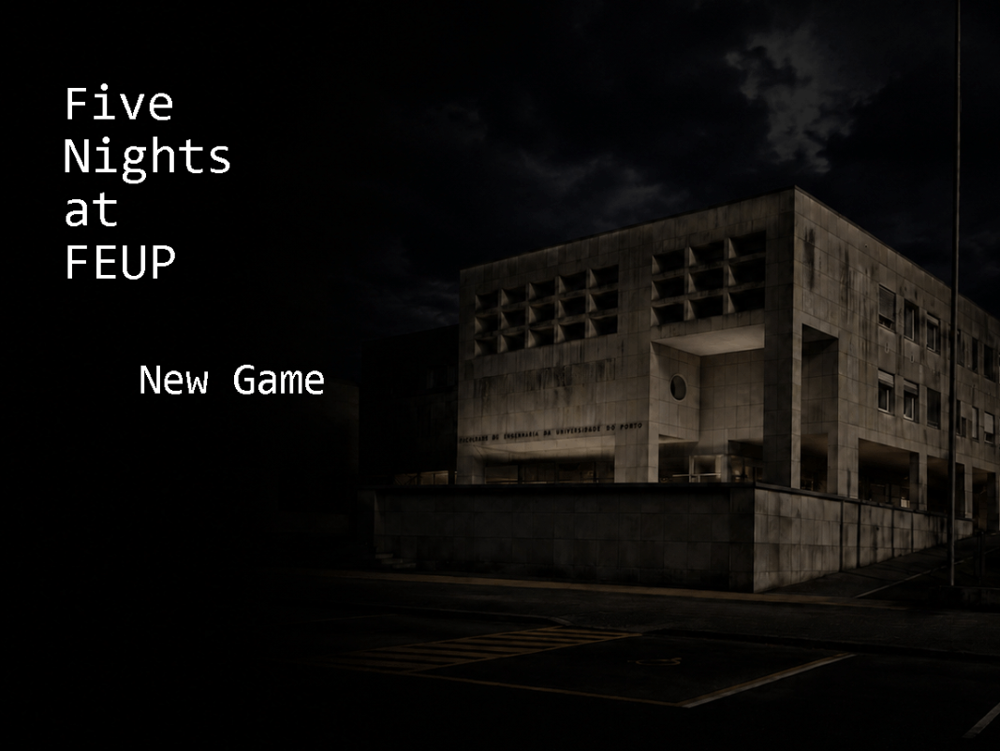
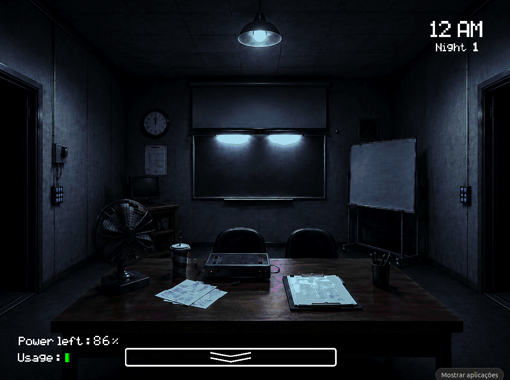
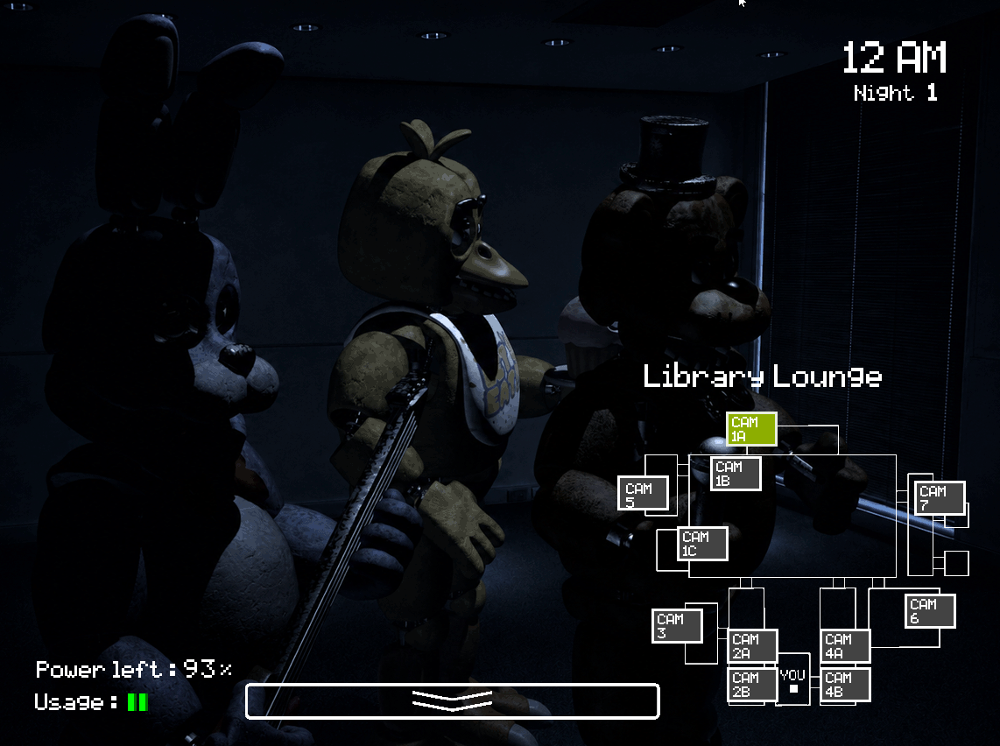
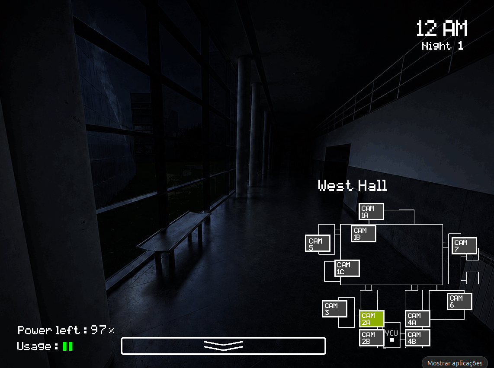
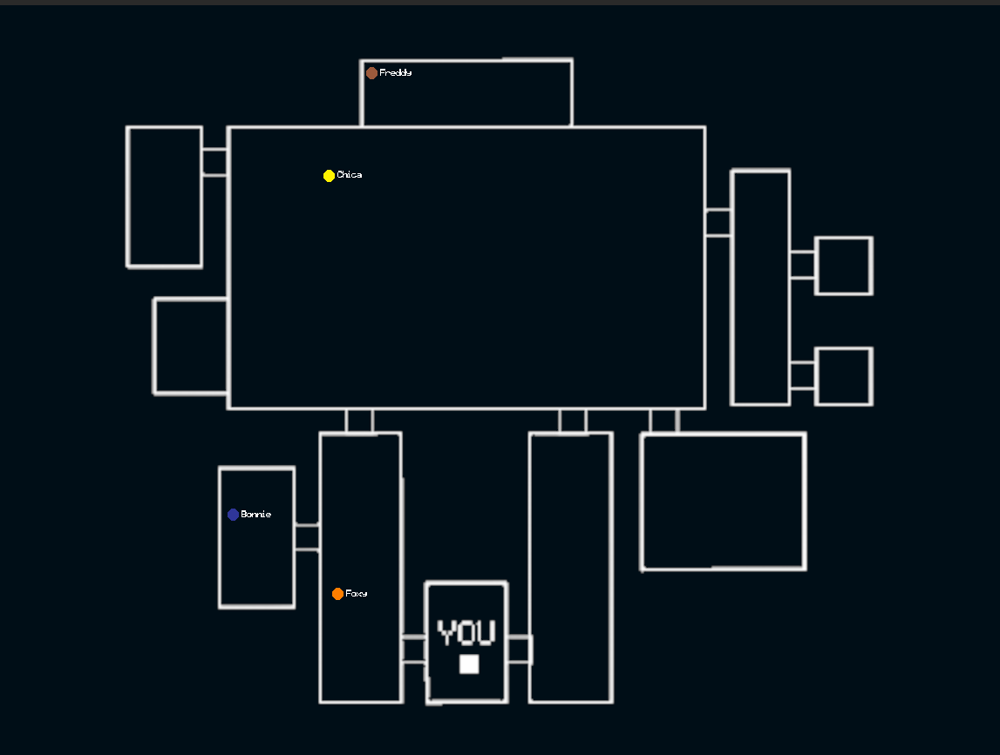
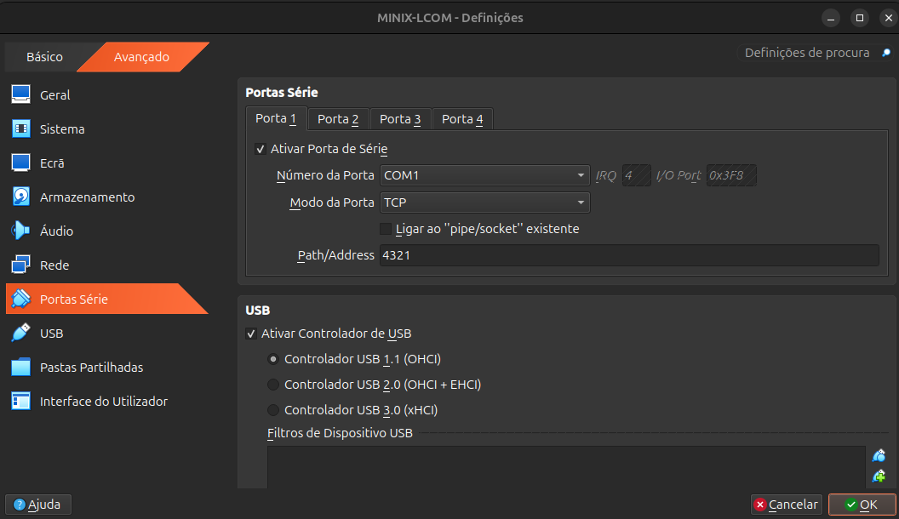
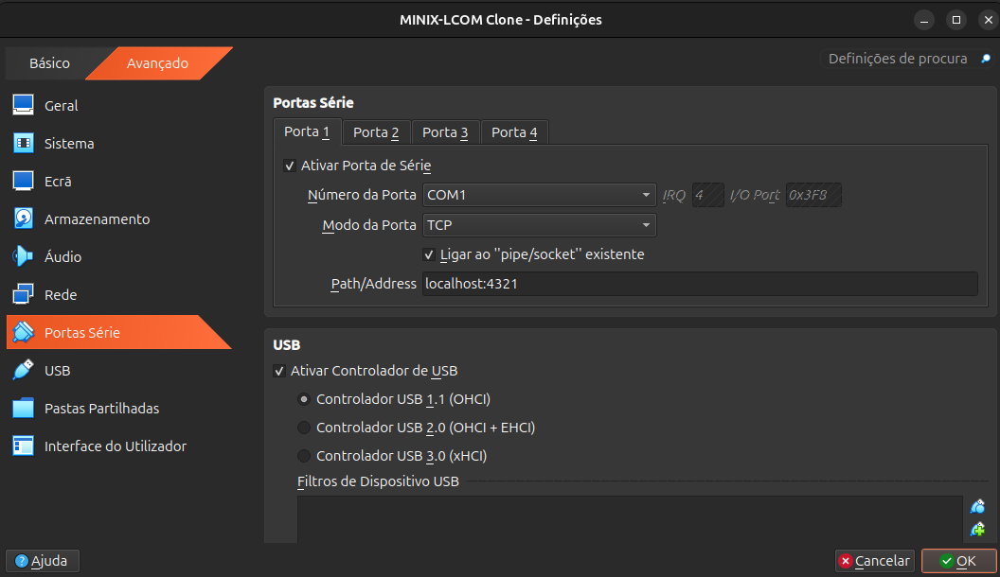

# Five Nights at FEUP

## Overview

The goal of our project - Five Nights at FEUP (FNAF) - was to recreate the feeling of the popular horror game, Five Nights at Freddy’s (FNAF), in a well-known environment of our faculty, FEUP.

Inside it, our job is to work as a FEUP security guard and survive our shift from 12 AM until 6 AM, while animatronics are roaming coming into our office to attack us. To prevent that, we can monitor their movement through cameras, close the doors and turn on the lights of our office, whilst keeping an eye on the current available battery that runs all our defense systems.

If we survive the night, we move on to the next night, or, if we survive the 5th night, we win the game. If we don’t survive the night, we get jumpscared by the animatronic that caught us and we lose the night and go back to the main menu, from where we can either start a new game or continue from the beginning of the night we lost.

## Screenshots










## How to Play

Inside a MINIX-LCOM virtual machine, in the project's root directory (`proj/`) compile all source code files with the command:

```shell
make all
```

Then, run the project with the command:

```shell
lcom_run proj
```

### Play Sound

To play the game's sound, in the Host PC, in the project's root directory (`proj/`), create and activate a Python virtual environment and install requirements with the commands:

```shell
python3 venv .venv
source .venv/bin/activate
pip install -r requirements.txt
```

After that, execute the `sound.py` file with the command:

```shell
python3 sound.py
```

After exiting the game, stop the execution of this file with `CTRL+C`.

### Monitor Gameplay

Another type of gameplay is possible when running the game in a separate virtual machine (connected via serial port to the first one) at the same time as the game is being played in the original virtual machine.

This alternative gameplay displays a map of the game being played in the original virtual machine and real-time animatronics’ positions.


*Monitoring Gameplay*

Connect via serial port another MINIX-LCOM virtual machine (Clone) with the first one (Original) with the following configurations:


*Original Serial Port Definitions*


*Clone Serial Port Definitions*

Start the clone virtual machine, and inside the project's root directory (`proj/`) (assuming all source files are compiled) run the command:

```shell
lcom_run proj "receiver"
```

After that, you are in the "monitoring" gameplay.

To exit, press the "ESC" key.


## Developers

This project was developed by:

* Gabriel Magalhães (<up202405890@up.pt>)
* Guilherme Cunha (<up202405961@up.pt>)
* José Archer (<up202307614@up.pt>)
* Pedro Pires (<up202405967@up.pt>)
